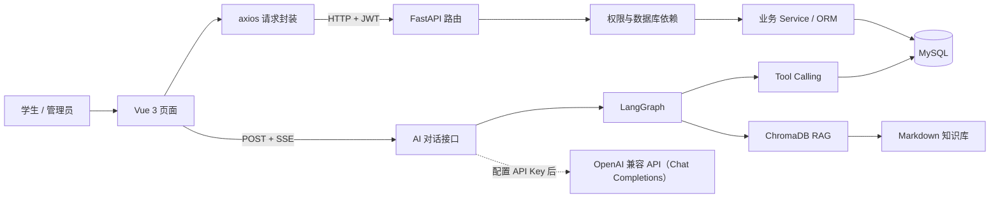
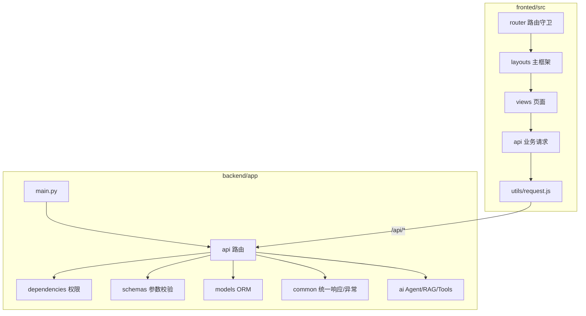
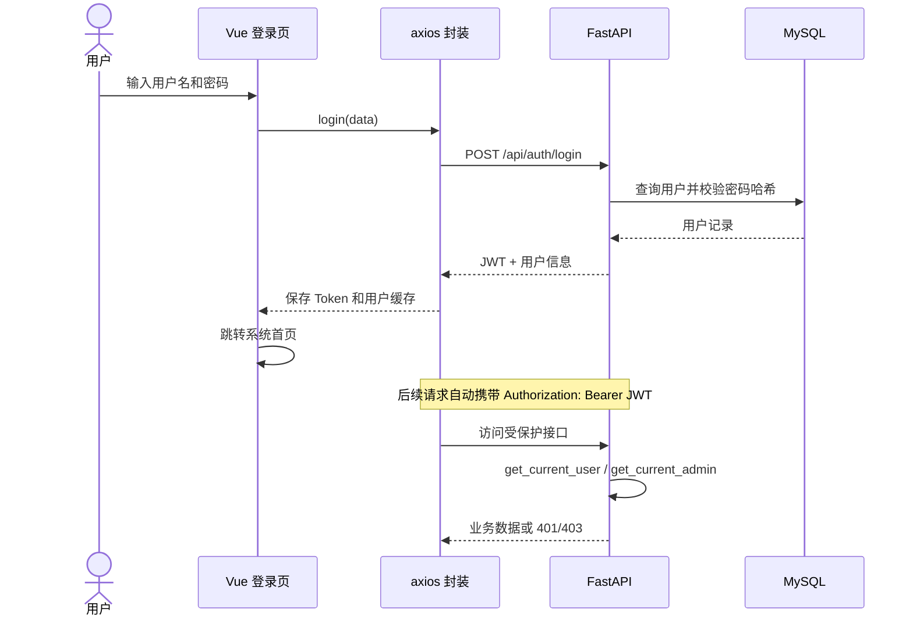
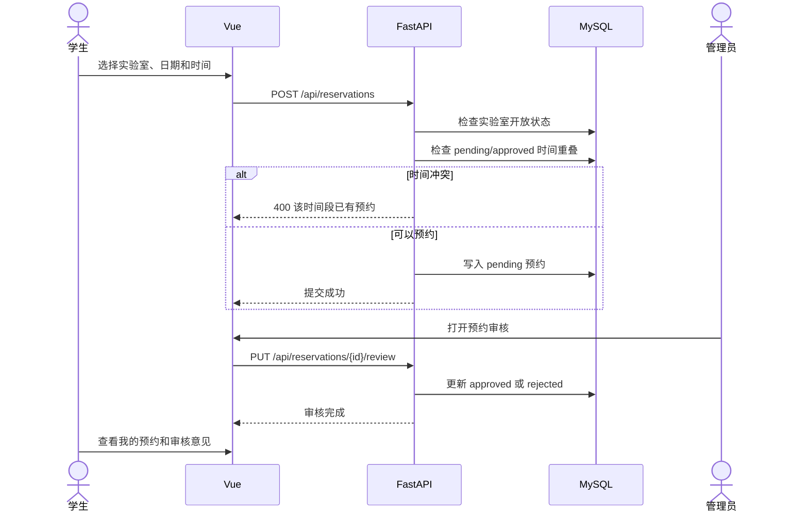
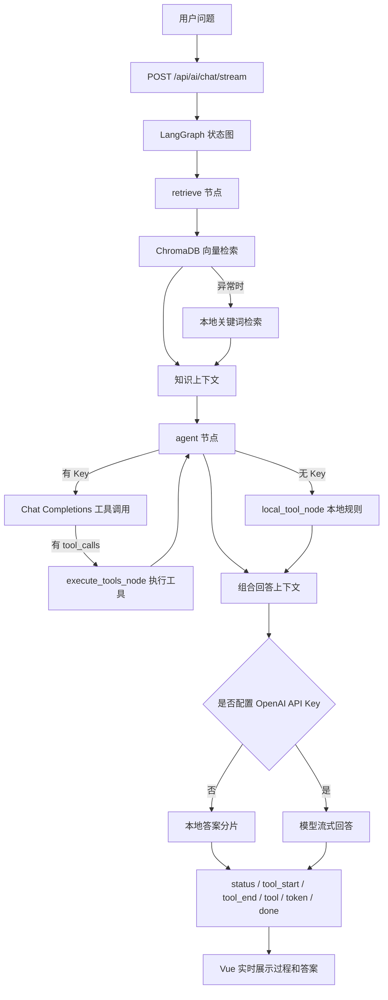

# 智能实验室预约系统：项目图解

建议先从“系统全景”理解模块边界，再沿着预约和 AI 两条主流程阅读代码。

## 1. 系统全景

阅读提示：

- Vue 只负责交互与展示，不能代替后端鉴权。
- axios 统一添加 JWT；FastAPI 的依赖再次验证用户和管理员权限。
- 普通业务数据存放在 MySQL；知识文档及向量索引由 Markdown 与 ChromaDB 管理。
- 没有 OpenAI API Key 时，LangGraph、RAG、工具查询和 SSE 仍可在本地运行。

## 2. 前后端代码映射

## 3. 登录与鉴权流程

## 4. 实验室预约主流程

时间冲突的核心判断是：`已有开始时间 < 新结束时间` 且 `已有结束时间 > 新开始时间`。这比只比较开始时间更完整，也能正确识别“包含”和“部分重叠”。

## 5. AI 助手处理流程

这里有三层“可继续替换”的设计：

1. `build_local_embedding()` 可替换为正式中文 Embedding 模型。
2. `ai/tools.py` 的工具（共十个）可继续扩展；图内 `execute_tools_node` 与图外 `run_model_tools()` 都统一经 `_execute_tool` 分发。
3. `stream_answer()` 已把本地回答与真实模型回答统一成流式迭代器，前端不需要区分实现。

## 6. 功能模块与代码入口

| 功能模块 | 前端入口 | 后端入口 |
| --- | --- | --- |
| 登录与鉴权（JWT、axios 封装、路由守卫） | `utils/request.js`、`utils/auth.js`、`router/index.js`、`views/login.vue`、`views/register.vue` | `api/auth.py`、`dependencies/auth.py`、`dependencies/permission.py`、`utils/jwt.py`、`utils/password.py` |
| 用户与个人中心（资料、密码、头像上传、管理员用户管理） | `views/user.vue` | `api/user.py`、`api/upload.py` |
| 实验室、设备与不可约时段 | `views/lab.vue`、`views/equ.vue` | `api/lab.py`、`api/equipment.py`、`api/blackout.py` |
| 预约与审核 | `views/reservation.vue` | `api/reservation.py`、`services/reservation.py` |
| 公告、报修与通知 | `views/announcement.vue`、`views/repair.vue`、`layouts/layouts.vue` | `api/announcement.py`、`api/repair.py`、`api/notification.py` |
| AI 助手（RAG、Tool Calling、LangGraph、SSE） | `views/chat.vue` | `api/ai.py`、`ai/knowledge.py`、`ai/tools.py`、`ai/agent.py` |
| 首页统计 | `views/home.vue` | `api/stats.py` |

