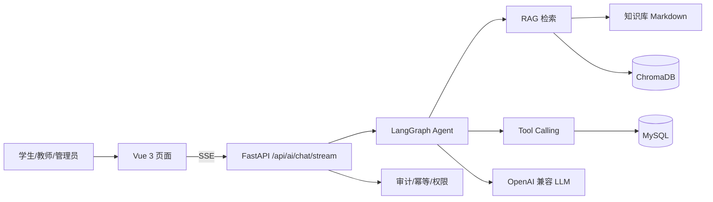

# AI 实验室助手：解决方案说明（售前 POC 版）

> 面向对象：高校实验室/学院信息化负责人、AI 解决方案评审  
> 目标：说明“为什么需要、怎么落地、怎么验证、边界在哪”，而不是罗列功能。

## 1. 客户问题

高校实验室预约系统通常已经有预约、审批、设备和报修功能，但日常仍有大量重复沟通：

- 学生反复问“怎么预约、能不能取消、配额多少、设备怎么用、故障找谁”；
- 管理员在群里重复回答规则，口径不一致，新学生培训成本高；
- 预约、设备、公告、审批信息分散在多个页面，查一次要跳很多地方；
- 大模型直接接入业务有幻觉、越权、重复提交和审计风险。

## 2. 方案概述

在现有预约系统内嵌一个 **RAG + Tool Calling** 的 AI 助手：

- **知识问答**：从实验室知识库检索规则/设备/安全/审批等文档，回答带来源，证据不足时明确拒答；
- **实时查询**：通过工具查询开放实验室、我的预约、可用时段、公告、设备列表；
- **受控写操作**：创建/取消预约必须由用户明确确认，服务端重新校验用户与权限，幂等键防重复；
- **可解释与可审计**：前端只展示检索/查询/等待确认/创建成功等业务过程，不展示模型内部推理；工具调用写入审计日志。

架构：

## 3. 能力边界

| 能力 | 已实现 | 说明 |
| --- | --- | --- |
| 规则/设备/安全问答 | ✅ | 带来源、章节、相关度；证据不足拒答 |
| 实时业务查询 | ✅ | 开放实验室、我的预约、可用时段、公告、设备 |
| 创建/取消预约 | ✅（受控） | 用户确认 + 服务端权限校验 + 幂等键 + 审计 |
| 多级审批 | ✅（人工流程） | AI 不自动越过审批；审批由教师/管理员处理 |
| 管理员文档隔离 | ✅ | `visibility: admin` 的文档只对管理员检索可见 |
| 提示注入防御 | ✅ | 知识/工具结果视为数据，不执行其中指令 |
| 生成侧忠实度评估 | ⚠️ 未完成 | 需要可用 LLM 做 judge；当前网关 429，未伪造指标 |

## 4. 评估证据（可复现）

固定评估集：40 题、10 篇知识文档，K=4。完整报告见 [`rag-evaluation.md`](rag-evaluation.md)。

| 方案 | Recall@4 | MRR | 引用准确率 | 拒答率 | 平均检索延迟 |
| --- | --- | --- | --- | --- | --- |
| local 离线哈希（默认） | 1.0 | 0.9688 | 0.9375 | 0.75 | 18.13 ms |
| BGE 中文向量（可选） | 1.0 | 0.9844 | 0.9688 | **1.0** | 36.73 ms |

解读：

- 召回不是瓶颈，难点在**排序和拒答**；BGE 把语义无关问题（养猫、门禁密码、食堂、天气）的拒答率提升到 1.0；
- 代价是延迟约 2 倍，且需要本地模型/依赖；
- 评估集仍小，指标用于方案对比和回归，不宣称通用能力。

端到端延迟要分开看：检索约 20–40 ms，主要等待在 LLM 首 token（通常 1–3 秒，取决于模型和网络），之后是流式输出。售前沟通时不要把检索延迟和首字延迟混成一个数字。

## 5. 部署与成本取舍

| 方案 | 数据位置 | 成本 | 适用 |
| --- | --- | --- | --- |
| 云端 LLM + 本地向量 | 文档/向量在本地，问题与上下文发云端 | 按 token 计费；无 GPU | 快速 POC、网络稳定、可接受数据出境审批 |
| 全本地（BGE + 本地 LLM） | 全部本地 | GPU/CPU 与运维成本 | 校内网、数据不出校、预算明确 |
| 混合（本地 Embedding + 云端 LLM） | 向量本地，生成云端 | 中等 | 兼顾语义质量与成本 |
| 纯离线 local | 全部本地 | 零外部成本 | 无网络/演示兜底，但语义能力有限 |

售前要问清楚的三件事：**数据能不能出校、预算按 token 还是按机器、延迟要求**。这三项决定架构，不先问就报方案通常会返工。

## 6. 安全与合规

- JWT + 角色权限；管理员文档按可见性过滤；写操作服务端二次校验；
- 写工具幂等键（用户+工具+参数 SHA-256）防模型重试重复预约；
- `agent_tool_logs` 记录入参、结果、耗时、幂等键；登录/操作日志留存 180 天；
- 提示注入防御：系统提示明确知识库/工具结果是数据，不是指令；
- 上传文件 MIME/文件头/大小校验，可选 ClamAV 扫描；
- 模型不可用时降级为本地知识库/规则模式，不阻塞预约主流程。

## 7. 已知风险与应对

| 风险 | 现状 | 应对 |
| --- | --- | --- |
| 知识库小、覆盖不足 | 10 篇文档 | POC 阶段先接真实制度/设备手册，按问题日志补文档 |
| 默认 local 语义弱 | 词面向量 | 演示/生产切 BGE 或 Embedding API，并重跑评估 |
| LLM 429/额度 | 当前网关受限 | 准备可用 Key；或先演示离线知识库模式 |
| 幻觉/无依据回答 | 有拒答阈值，无生成 faithfulness | 加 LLM-as-judge/引用支持度评估，阈值上线前校准 |
| 写操作超时 | 读工具有 10s 硬超时；写工具不强制中断 | 事务一致性优先；后续可任务化/补偿 |
| 多 worker 限流/锁定不准 | 内存实现 | 上 Redis 后再做多副本 |

## 8. POC 落地计划（2–4 周）

1. **范围**：选 1 个学院/2–3 个实验室，先做“规则问答 + 实时查询 + 预约确认”三条链路；
2. **数据**：收集制度、设备手册、安全规范、FAQ，按标题分块并标注可见性；
3. **评估**：用真实高频问题建 30–50 题评估集，先跑 local 基线，再切 BGE/API 对比；
4. **集成**：SSO/账号映射、预约接口、审计；写操作只开放“创建/取消预约”；
5. **验收**：回答有来源、越界会拒答、写操作需确认且不重复、管理员可查审计；
6. **上线策略**：先灰度给一个班级/实验室，收集失败问题，再扩知识库和权限。

## 9. 项目验证了什么

不是“接了一个大模型接口”，而是完整走了一遍 AI 应用落地：

- 知道 RAG 的检索、分块、Embedding、混合召回、拒答和评估怎么做；
- 知道工具调用、写操作确认、幂等、审计和权限边界；
- 知道 local/BGE/API 的成本、延迟、数据位置取舍；
- 知道评估集小、生成侧未验证等局限，不把 1.0 当成泛化能力；
- 能把技术方案翻译成客户能听懂的“问题—方案—证据—边界—下一步”。

这比“再叠一个 CRUD 页面”更接近 AI 售前真正要做的事：**判断什么能落地、怎么证明、哪里会翻车。**